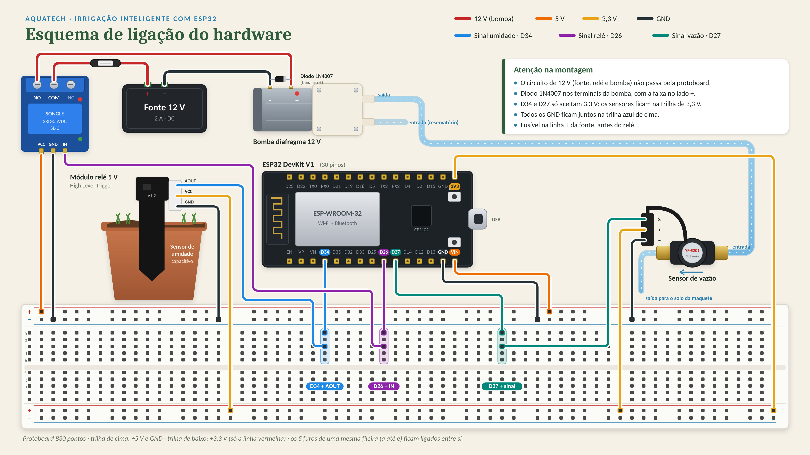

# Firmware e hardware do ESP32

Esta pasta tem o código do ESP32 e tudo o que é preciso para montar o hardware do AquaTech: lista de materiais, pinagem, esquema de ligação, configuração e calibração.

O ESP32 lê a umidade do solo e a vazão de água, decide sozinho quando ligar e desligar a bomba e envia os dados para a API do sistema. **Se o Wi-Fi ou o servidor caírem, a irrigação continua funcionando** com os limites padrão.



## Materiais

| Componente | Modelo usado |
|---|---|
| Microcontrolador | ESP32 DevKit V1 (30 pinos, conversor USB CP2102) |
| Sensor de umidade do solo | Capacitivo v1.2 |
| Sensor de vazão | YF-S201 (1 a 30 L/min) |
| Relé | Módulo 1 canal 5 V, Songle SRD-05VDC-SL-C, High Level Trigger |
| Bomba | Bomba diafragma 12 V (tipo 385) |
| Fonte | 12 V, 2 A |
| Proteção | Diodo 1N4007 nos terminais da bomba e fusível na linha + da fonte |
| Resistor | 10 kΩ (pull-up do sinal do sensor de vazão) |
| Montagem | Protoboard 830 pontos, jumpers macho-fêmea e macho-macho, mangueira |

## Pinagem

| Pino do ESP32 | Ligado a | Observação |
|---|---|---|
| D34 | AOUT do sensor de umidade | Entrada analógica (ADC1, funciona com Wi-Fi ligado) |
| D27 | Sinal do sensor de vazão | Contagem de pulsos por interrupção |
| D26 | IN do relé | HIGH liga a bomba |
| VIN | VCC do relé | 5 V vindos do USB |
| 3V3 | VCC dos dois sensores | Os pinos D34 e D27 só aceitam até 3,3 V |
| GND | GND de todos os módulos | Todos os GND ficam ligados juntos |

## Ligações na protoboard

A protoboard tem duas bordas de energia, que **não são ligadas entre si**:

- **Borda "5V"** (a de cima no esquema): linha vermelha = 5 V, linha azul = GND.
- **Borda "3,3V"** (a de baixo no esquema): só a linha vermelha é usada, com 3,3 V.

Cada sinal se encontra com o seu componente numa fileira do meio da protoboard (os 5 furos de uma mesma fileira, de "a" até "e", ficam ligados entre si).

| # | De | Para | Jumper |
|---|---|---|---|
| 1 | ESP32 VIN | Borda 5V, linha vermelha | Macho-fêmea |
| 2 | ESP32 GND | Borda 5V, linha azul | Macho-fêmea |
| 3 | ESP32 3V3 | Borda 3,3V, linha vermelha | Macho-fêmea |
| 4 | ESP32 D34 | Fileira 20, furo a | Macho-fêmea |
| 5 | ESP32 D26 | Fileira 25, furo a | Macho-fêmea |
| 6 | ESP32 D27 | Fileira 30, furo a | Macho-fêmea |
| 7 | Relé VCC | Borda 5V, linha vermelha | Fio do módulo |
| 8 | Relé GND | Borda 5V, linha azul | Fio do módulo |
| 9 | Relé IN | Fileira 25, furo c | Fio do módulo |
| 10 | Sensor de umidade AOUT | Fileira 20, furo c | Macho-macho |
| 11 | Sensor de umidade VCC | Borda 3,3V, linha vermelha | Macho-macho |
| 12 | Sensor de umidade GND | Borda 5V, linha azul | Macho-macho |
| 13 | Sensor de vazão, sinal (amarelo) | Fileira 30, furo c | Macho-macho |
| 14 | Sensor de vazão, + (vermelho) | Borda 3,3V, linha vermelha | Macho-macho |
| 15 | Sensor de vazão, − (preto) | Borda 5V, linha azul | Macho-macho |
| 16 | Resistor 10 kΩ | Entre a fileira 30 e a borda 3,3V, linha vermelha | Macho-macho nas duas pontas |

### Circuito de 12 V (fora da protoboard)

| De | Para |
|---|---|
| Fonte + | Fusível e depois relé COM |
| Relé NO | Bomba + |
| Fonte − | Bomba − |
| Diodo 1N4007 | Entre os terminais da bomba, com a faixa no + |

O circuito de 12 V nunca passa pela protoboard. Use o terminal **NO** do relé: assim a bomba fica desligada quando o ESP32 está desligado.

## Caminho da água

Reservatório → bomba → sensor de vazão → solo. A seta no corpo do sensor de vazão deve apontar da bomba para o solo, e a entrada da bomba deve ficar sempre abaixo do nível da água.

## Como gravar o firmware

1. Instale a **Arduino IDE 2.x**.
2. Em **Arquivo > Preferências**, adicione em "URLs adicionais do Gerenciador de Placas":
   `https://espressif.github.io/arduino-esp32/package_esp32_index.json`
3. No **Gerenciador de Placas**, instale **esp32 by Espressif Systems**.
4. Instale o driver do conversor USB da placa. Nesta placa é o **CP2102** (driver "CP210x Universal Windows Driver", da Silicon Labs).
5. Abra `aquatech_esp32/aquatech_esp32.ino`, escolha a placa **DOIT ESP32 DEVKIT V1** e a porta COM da placa.
6. Preencha o bloco **PREENCHER ANTES DE CARREGAR** (veja abaixo) e clique em **Carregar**. Se a IDE ficar parada em "Connecting....", segure o botão **BOOT** até aparecer a porcentagem.

Não publique o arquivo com a senha do Wi-Fi e a chave preenchidas.

## Configuração

| Constante | O que colocar |
|---|---|
| `WIFI_NOME` / `WIFI_SENHA` | Rede Wi-Fi **2,4 GHz**, com segurança **WPA2** |
| `SERVIDOR` | `http://IP_DO_COMPUTADOR:5000`, o computador que roda o `docker compose`. Ele e o ESP32 precisam estar na mesma rede |
| `CODIGO_DISPOSITIVO` | Código cadastrado no sistema, por exemplo `ESP32-001` |
| `CHAVE_DISPOSITIVO` | Chave gerada no cadastro do dispositivo |

### Cadastrar o dispositivo e gerar a chave

Com o sistema rodando (`docker compose up -d --build`), entre no site, conclua o cadastro da propriedade e rode na raiz do projeto:

```
docker compose exec app python scripts/cadastrar_dispositivo.py --email EMAIL_DO_USUARIO --codigo ESP32-001
```

A chave aparece na linha "Chave". No Windows, libere a porta 5000 no firewall do computador que roda o servidor, para o ESP32 conseguir acessá-lo.

## Calibração do sensor de umidade

O sensor é convertido em porcentagem com dois valores medidos (leitura bruta do `analogRead`):

| Situação | Valor medido | Porcentagem |
|---|---|---|
| Sensor seco, no ar | 2620 | 0% |
| Sensor na água, até a linha branca | 930 | 100% |

Cada sensor tem valores um pouco diferentes. Para recalibrar, leia o valor bruto no ar e na água e atualize `VALOR_SECO` e `VALOR_MOLHADO`. No teste "no ar", segure o sensor pela parte de cima, sem encostar a sonda em nenhuma superfície.

## Lógica de irrigação

- Umidade **abaixo de 18%**: liga a bomba.
- Umidade **a partir de 30%**: desliga a bomba.
- Entre os dois valores: mantém o estado atual, para a bomba não ficar ligando e desligando.

Os limites padrão são substituídos pelos limites cadastrados na propriedade, que o ESP32 busca na API a cada minuto.

### Previsão de chuva

Junto com os limites, a API informa `chuva_prevista` (o servidor consulta a API Open-Meteo para a cidade configurada):

- Com chuva prevista e o solo seco, a irrigação é **adiada**: o Serial mostra `[CHUVA] Solo seco, mas ha chuva prevista: irrigacao adiada`.
- Se a bomba já estiver ligada e a chuva ficar prevista, ela desliga antes de chegar a 30%.
- **Exceção de segurança:** abaixo de `umidade_critica` (8%) a bomba liga mesmo com chuva prevista, e desliga 5 pontos acima disso. A previsão pode errar e uma planta coberta não recebe chuva.
- Se o ESP32 ficar 10 minutos sem resposta do servidor, ele ignora a previsão e irriga normalmente pela umidade.
- **Demonstração:** com o Monitor Serial aberto, digite `c` e Enter para simular chuva. Digite `c` de novo para desligar a simulação.

## Calibração do sensor de vazão

O fabricante do YF-S201 indica 7,5 pulsos por segundo para cada 1 L/min. Com a bomba de diafragma, a água sai em pulsos e a hélice do sensor gera contagens extras, então esse valor mediu cerca de 6 vezes mais água do que passou de verdade. Três correções foram aplicadas:

1. **Filtro no código:** pulsos com menos de 4 ms de intervalo são ignorados (ruído na borda do sinal).
2. **Resistor de 10 kΩ** entre o sinal do sensor (fileira do D27) e o 3,3 V, para deixar o sinal mais firme.
3. **Fator calibrado:** passando 1 litro medido pelo sistema, o fator ficou em **43,5** (`FATOR_VAZAO`). Com ele, a vazão medida com a bomba ficou em torno de 3 L/min.

Para recalibrar, reinicie o ESP32, passe um volume conhecido pela bomba e ajuste: `novo fator = fator atual × (total medido ÷ volume real)`.

## Comunicação com a API

| Quando | Rota |
|---|---|
| A cada 5 s | `POST /api/dispositivos/<codigo>/leituras` com `umidade_solo` e `vazao_agua` |
| Ao ligar e a cada 60 s | `GET /api/dispositivos/<codigo>/configuracao` (limites e `chuva_prevista`) |
| Quando a bomba liga ou desliga | `PUT /api/dispositivos/<codigo>/irrigacao`, com os litros medidos na irrigação |

Todas as requisições enviam a chave no cabeçalho `X-Chave-Dispositivo`.

## Problemas conhecidos e soluções

| Problema | Causa | Solução |
|---|---|---|
| A porta COM não aparece | Falta o driver do CP2102 | Instalar o driver da Silicon Labs |
| Upload falha em "Connecting...." | A placa não entrou no modo de gravação | Segurar o botão BOOT durante o upload |
| Upload falha em "Unable to verify flash chip connection" | Velocidade de gravação alta para a placa | Em Ferramentas, baixar Upload Speed para 115200 |
| O Wi-Fi não conecta ou demora muito | A placa veio com o MAC de fábrica zerado (00:00:00:00:00:00) | O firmware define um MAC válido com `esp_wifi_set_mac` |
| O Wi-Fi cai de tempos em tempos (motivo 200) | Modo de economia de energia do Wi-Fi | O firmware desliga a economia com `WiFi.setSleep(false)` |
| Umidade em 100% o tempo todo | Sensor desconectado ou sem energia | Conferir AOUT no D34, VCC no 3,3 V e GND |
| Vazão muito acima do real | Pulsos extras da bomba de diafragma e ruído no sinal | Filtro de 4 ms, resistor de 10 kΩ e `FATOR_VAZAO` calibrado |
| Umidade alta com o sensor no ar | Sensor úmido ou encostado numa superfície | Secar o sensor e segurá-lo no ar |
| Rede do celular não conecta | Roteador do celular em WPA3 ou 5 GHz | Configurar WPA2 e 2,4 GHz |
